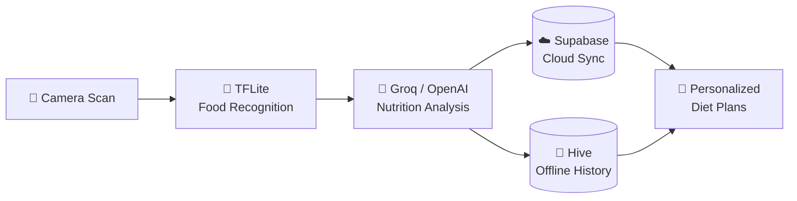

<!-- ============================== HEADER ============================== -->


<div align="center">

<a href="https://github.com/uwaim45264">
  
</a>

<br/>

<a href="https://uwaim45264.github.io/portfolio/"></a>
<a href="mailto:unknownmuq@gmail.com"></a>
<a href="https://www.linkedin.com/in/muhammad-uwaim-55039b267/"></a>
<a href="https://youtube.com/@MUQ_UNKNOWN"></a>
<a href="https://twitter.com/MUQUnknown1"></a>

<br/><br/>


</div>

<br/>

<!-- ============================== ABOUT ============================== -->
## 👋 About Me


I'm a **software engineer & full-stack developer** who turns ideas into fast, polished, user-centric apps. I specialize in **Flutter**, **AI/ML** and **AR**, and I care as much about clean architecture as I do about pixel-perfect UI.

```yaml
role:      Software Engineer · Full-Stack Developer
focus:     Flutter · AI/ML · Augmented Reality
mindset:   Clean code, great UX, real-world impact
status:    Open to work 🟢
```

- 💼 Freelance developer with **published apps**
- 🤖 Passionate about **AI/ML** and **AR**
- 🎨 UI/UX enthusiast with a design-thinking approach
- 🌍 Building solutions for **global impact**
- ☕ Always up for interesting projects and tech chats

<br clear="right"/>

---

<!-- ============================== SPOTLIGHT ============================== -->
## ⭐ Spotlight: NutriScan AI

> **An AI nutrition assistant** — point your camera at food, get an instant nutritional breakdown and personalized diet suggestions.

<div align="center">

<a href="https://github.com/uwaim45264/NutriScan-AI"></a>


</div>



| Feature | |
|:--|:--|
| 📸 **Smart Food Scanning** | Identify food with the camera (TFLite & Mobile Scanner) |
| 🤖 **AI-Powered Analysis** | Calories, macros and vitamins powered by Groq/OpenAI |
| 📊 **Nutrient Tracking** | Meal history and progress over time |
| 🧘 **Personalized Diet Plans** | Suggestions tailored to BMI and health goals |
| ☁️ **Cloud Sync + 📴 Offline** | Supabase sync with Hive for offline access |

---

<!-- ============================== PROJECTS ============================== -->
## 🚀 Open-Source Repositories

<div align="center">

<a href="https://github.com/uwaim45264/NutriScan-AI"></a>
<a href="https://github.com/uwaim45264/GROCEROY-APP-FLUTTER-SS"></a>
<a href="https://github.com/uwaim45264/Portfolio-"></a>
<a href="https://github.com/uwaim45264/uwaim45264"></a>

</div>

| Project | What it is | Stack |
|:--|:--|:--|
| 🥗 **[NutriScan AI](https://github.com/uwaim45264/NutriScan-AI)** | AI nutrition scanner with diet plans, cloud sync and offline mode | Flutter · Groq/OpenAI · Supabase · Hive · TFLite |
| 🛍️ **[Grocery App](https://github.com/uwaim45264/GROCEROY-APP-FLUTTER-SS)** | Grocery shopping app, cross-platform (Android, iOS, web, desktop) | Flutter · Dart |
| 🌐 **[Portfolio](https://github.com/uwaim45264/Portfolio-)** | Personal portfolio website — [live site](https://uwaim45264.github.io/portfolio/) | HTML · CSS · JS |

### 📦 More Projects

These apps are part of my work history; source code is available on request.

| Project | Description | Skills |
|:--|:--|:--|
| 🤖 **AI Image Verification** | Image classification with real-time model inference in Flutter | ML integration · CV preprocessing |
| 🥽 **AR Study Buddy** | Augmented-reality study assistant with interactive learning tools | ARCore/ARKit · 3D interaction |
| 📸 **Paper Scanner** | Document scanner with edge detection and OCR | Image processing · OCR |
| 🛒 **Mobile Shop Desktop** | Cross-platform e-commerce app with inventory management | State management · Firebase |
| 📰 **MUQ News** | News aggregation app with categorized feeds | REST APIs · push notifications |
| 🎮 **Space Raider** | 2D action game built with the Flame engine | Game loop · collisions |
| ✅ **Smart To-Do App** | Task manager with a clean UI | State persistence · UI polish |

<div align="center">

<a href="https://github.com/uwaim45264?tab=repositories"></a>

</div>

---

<!-- ============================== TECH STACK ============================== -->
## 🛠️ Tech Stack

<div align="center">

| | |
|:--|:--|
| **📱 Mobile** |    |
| **🤖 AI & Backend** |     |
| **☁️ Cloud & Data** |     |
| **🎨 Frontend & Design** |     |
| **🧰 Tools** |   |

</div>

---

<!-- ============================== ANALYTICS ============================== -->
## 📊 GitHub Analytics

<div align="center">


</div>

---

<!-- ============================== FOCUS ============================== -->
## 🎯 Current Focus

| | |
|:--|:--|
| 🚀 | Building advanced **AI-powered mobile apps** |
| 🧠 | Going deeper into **Machine Learning** and **Computer Vision** |
| 🎨 | Sharpening **UI/UX design** for enterprise-grade products |
| 📱 | Publishing new apps on the **Google Play Store** |
| 🌍 | Contributing to **open-source** projects |

<div align="center">

`Application Development` · `Mobile Solutions` · `AI/ML Integration` · `AR Technology` · `UI/UX Design` · `Full-Stack Development` · `Database Architecture` · `Cloud Services`

</div>

---

<!-- ============================== CONNECT ============================== -->
## 🤝 Let's Connect

<div align="center">

**Open to:** &nbsp; Freelance Projects &nbsp;•&nbsp; Collaborations &nbsp;•&nbsp; Full-time Roles &nbsp;•&nbsp; Consulting

<br/>

<a href="mailto:unknownmuq@gmail.com"></a>
<a href="https://uwaim45264.github.io/portfolio/"></a>
<a href="https://www.linkedin.com/in/muhammad-uwaim-55039b267/"></a>
<a href="https://youtube.com/@MUQ_UNKNOWN"></a>
<a href="https://twitter.com/MUQUnknown1"></a>

<br/><br/>

> *"The best code is not just functional — it's elegant, maintainable, and solves real problems."*

</div>

<!-- ============================== FOOTER ============================== -->


<p align="center"><sub>Made with ❤️ by Muhammad Uwaim Qureshi</sub></p>
